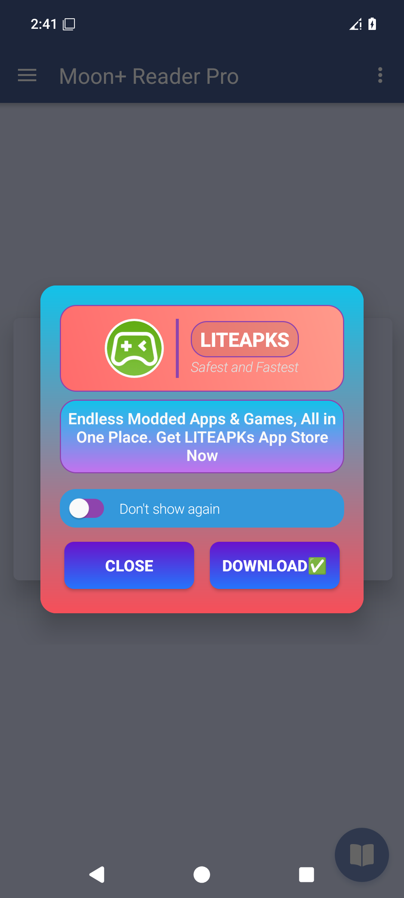

# Android runtime results

**The retained run covers 10 of the 36 canonical cases at least in part: 3 pass,
6 partial, and 1 fail. Another 7 cases are blocked and 19 were not run.** These
counts describe the [application test matrix](testing-plan.md), not individual
screenshots, fixture checks, host tests, or the additional observations below.

The tested file is an **unknown-origin, user-supplied APK**, declaring
`com.flyersoft.moonreaderp` **10.8 / 1008000**. Its installed bytes match:

```text
e2c0ef649413b2f6671598ac8b027d582ba220e38738f2e253694289ea20e1fc
```

Default `apksigner` verification reported v1 digest mismatches in `classes3.dex`
and `classes5.dex`. The unmodified APK was accepted by this Android package
manager. **Installation acceptance does not authenticate the publisher.** Every
application observation here, including the promotion and PDF failure, is
specific to these bytes and this environment; none establishes an official
Play-build defect. See [artifact identity](../data/artifact.json) and the
[original verification excerpt](../evidence/apk-signature-verification.txt).

## Evidence and counting

- [Structured results](../data/runtime-results.json): all 36 cases, numbered
  steps for executed cases, input hashes, expected/actual results and subchecks.
- [Evidence manifest](../evidence/runtime/manifest.json): SHA-256 and byte size
  of each selected screenshot, XML tree, diagnostic excerpt and synthetic output.
- [Sanitized command excerpts](../evidence/runtime/commands-sanitized.jsonl):
  actual ADB arguments, UTC start times, exit codes, elapsed times and source-log
  line numbers. Host file arguments are explicitly replaced by placeholders.
- [Environment](../evidence/runtime/environment.json),
  [review and exclusions](../evidence/runtime/review-and-exclusions.json),
  [cleanup](../evidence/runtime/cleanup.json), and
  [delivery verification](../evidence/runtime/verification.json).

**Pass** means the case's stated acceptance checks were observed. **Partial**
means some actions succeeded but specified steps remain unexecuted. **Fail**
means an exercised acceptance check failed; it does not imply that every
companion step was performed. **Blocked** identifies an unavailable prerequisite,
not an application failure. **Not run** means there is no execution of that
workflow. The JSON splits partial cases into subchecks so a successful link,
rendered page or dialog cannot be mistaken for a whole-case pass.

The original private 12-case plan used different numbers. In particular, its
`RT-03` was `ORANGEQUARTZ` search, related to current **RT-11**, not current
RT-03's document-provider URI lifecycle. Its `RT-04` was note persistence on a
separate synthetic input, auxiliary to current **RT-14**, not current RT-04
navigation. The JSON includes the complete historical mapping.

## Environment and input boundary

Observed on **21 November 2026** in the disposable, account-free AVD
`reader_audit_api36_20261121_c375e7e3`, explicitly addressed as
`emulator-5596` through the private ADB server `localhost:5049`.

| Property | Recorded value |
|---|---|
| System | AOSP Android 16, API 36, x86_64, system-image revision 2 |
| Fingerprint | `Android/sdk_phone64_x86_64/emu64x:16/BE2A.250530.026.D1/13818094:userdebug/test-keys` |
| Security patch / memory pages | 2025-07-05 / 4096 bytes |
| Viewport / density / font scale | 1080 × 2400, portrait / 420 dpi / 1.0 |
| Emulator | SwiftShader, 4096 MiB, 4 cores, headless, `-no-audio` |
| Network at readiness | Wi-Fi and mobile data disabled; no IPv4 routes; both network backends configured `restrict=on,ipv6=off` |
| Accounts at readiness | 0 |
| Permission used | All-files access granted within the disposable guest; appops readback `allow` |
| Reading mode | Original PDF pages; OpenGL explicitly confirmed for documents showing an engine-choice dialog |
| Locale | English UI and `en_US` activity configuration observed; `persist.sys.locale` was empty |
| Speech / assistive technology | No TTS service returned; default synth `null`; no accessibility service enabled; no TalkBack task completed |

Readiness values are dated evidence, not a claim that the emulator remains
running. **Owned runtime cleanup completed at 17:59:07 UTC on 21 November 2026.**
After verifying all 105 preserved evidence files, the cleanup process acquired
the exclusive driver lock and checked process creation times, executable/AVD
identity and private-port bindings. Explicitly targeted `emu kill` and
`kill-server` commands returned exit 0; retained process handles signaled exit,
and the final check found no owned processes or listeners on ports 5049/5596/5597.
The cleanup process then exited, releasing its lock. See the
[cleanup receipt](../evidence/runtime/cleanup.json). No Android tests were rerun
during this shutdown.

All 11 [canonical documents](../fixtures/manifest.json) and all seven
[scenario inputs](../data/scenario-fixtures.json) were copied and hash-verified.
**Nine distinct canonical PDFs were actually opened. No scenario application
case was executed.** Copying files and authoring a driver phase count as zero
application passes. The EPUB and two-column PDF remain untested.

The separate [legacy-core input](../evidence/runtime/inputs/legacy-core.pdf)
was also exercised. Its SHA-256 is
`78a6ff18fee13374e2b0a7d23badeb9e4a2d2d19935ab4d367b5346367e2d818`.
It is not a canonical corpus fixture; the visible v1 footer and private v2
directory naming do not override its byte identity.

## Main observations

### Installation, promotion and storage onboarding

One original-APK installation returned **Success**, exit 0. The initial cold
activity launch reported `Status: ok`, `TotalTime: 2619` ms and `WaitTime: 2628`
ms. These are activity-launch timings, not completed-document rendering times.

The initial UI displayed **LITEAPKS**, a modded-app-store invitation, and CLOSE
and DOWNLOAD buttons. The audit selected CLOSE. The same promotion reappeared
during the later main-screen inspection. These are sample-provenance
observations, not evidence of official Moon behavior, a download, network
contact, or malware behavior.



The storage explanation described opening books through the system Files app
without all-files access. The audit instead granted the permission in the
disposable guest. **The described permission-free route was not tested.**
Evidence: [storage explanation](../evidence/runtime/03-after-promotion.xml),
[appops readback](../evidence/runtime/05-storage-appop.txt), and
[install outcome](../evidence/runtime/01-install-result.json).

### Rendering, navigation and search

- **Canonical navigation:** one controlled page 1 → 3 → 1 link cycle and one
  page-down reached `NAVIGATION-START`, `NAVIGATION-END` and
  `NAVIGATION-MIDDLE`, with matching indicators. Outline and history operation
  were not established; RT-04 is partial.
- **Mixed geometry:** all four media boxes and PDF rotations 0/90/180/270
  showed the expected markers and borders in a portrait viewport. PDF rotation
  is not device rotation; RT-05 is partial.
- **Long document:** pages 1, 100 and 50 visibly rendered; closing with
  Back → Exit, force-stopping and reopening restored page 50. The initial open
  reached page 1, but an explicit jump back to page 1 was not performed; RT-07
  is partial under the exact specification.
- **Search:** `lighthouse-427` and `LONG-DOC-PAGE-100` each returned one matching
  snippet; activation visibly highlighted the target text. The four search
  option checkboxes were unchecked, and the dialog advertised regular-expression
  support. Literal/metacharacter and invalid-pattern queries were not executed.
- **Bounded appearances:** the six canonical annotation appearances, the
  precomposed Latin/symbol strings, and the image-only page's square, triangle
  and `SCAN-ANCHOR-846` were visible. These do not establish annotation CRUD,
  Unicode-wide correctness, OCR, selection, speech, or reflow.
- **Legacy-core auxiliary:** page 1 rendered, its internal link reached
  `THIRD_PAGE_MARKER` on page 3, and `ORANGEQUARTZ` search returned one page-1 hit
  whose activation visibly highlighted the word. This different input adds no
  canonical case pass.

Selected evidence: [forward link](../evidence/runtime/35-navigation-link-forward-controlled.png),
[return link](../evidence/runtime/36-navigation-link-return-controlled.png),
[geometry page 2](../evidence/runtime/40-geometry-page2.png),
[restored page 50](../evidence/runtime/85-long-position-reopened.png),
[plain search](../evidence/runtime/plain-search-result.json), and
[long search](../evidence/runtime/long-search-result.json).

One incidental anomaly remains **observed once, not repeated**: after activating
the correct `lighthouse-427` result, the one-page PDF displayed **`101/1`** while
showing and highlighting the correct text. RT-11's query/result-activation
checks passed; this separate page-indicator observation is retained as
`AUX-STATUS-001`, without a general navigation or root-cause claim.
[Original screenshot and indicator](../evidence/runtime/75-plain-lighthouse-selected.png).

### Saved note: durable, with a contaminated earlier attempt

A verified single entry of `AUDIT_NOTE_PERSIST_20261121` was confirmed using
the Note dialog's OK button, followed by Back/Exit, a PDF pull and force-stop/
reopen. Retained PyMuPDF inspection found that **exact standalone text** in a
page-1 Highlight object; the reopened note popup showed it again.

The [saved output](../evidence/runtime/outputs/legacy-core-notes.pdf) has SHA-256
`7e203e424dc989ec8d2aed970fb7cbf4203c5ff89b94878cf8db8946d3defacc`.
It also contains an earlier concatenated marker from two overlapping driver
inputs. This is **harness contamination**, not an app duplication defect or a
second clean persistence trial. The exact standalone object, rather than the
original checker's substring boolean alone, supports the claim.

Evidence: [input readback](../evidence/runtime/23-note-entered-once.xml),
[retained PDF inspection](../evidence/runtime/27-note-pdf-persistence.json), and
[reopened note](../evidence/runtime/28-note-open-after-restart.png).
This is auxiliary evidence on the legacy-core input, not completion of canonical
RT-14's create/edit/delete/geometry workflow.

### Repeated saved-form interoperability failure

**`RUNTIME-PDF-PREV-001`: two separately edited outputs append an incremental
trailer containing `/Prev -1`.** The canonical input opens without repair and
has its original xref at byte 7523. Both outputs retain the full original prefix.

| Input/output | SHA-256 |
|---|---|
| Canonical `acroform.pdf`, 8,218 bytes | `3a7b514b4a6c01640bd27436857826bc258cf10b6f7ac4e58ce1c3f7af842402` |
| First saved output, 12,530 bytes | `af860b1720c51d4f2ebaca787c80e9230d201ababbc9599f41c1b12e2de0067a` |
| Text-only repeat, 10,962 bytes | `4f189a85b395615b8ae6726f333bb7e4805ae52b4d7cb5621e7f6d718425d9d9` |

Numbered reproduction and actual outcomes:

1. Open a writable device copy of the unchanged canonical form. Change the
   name to `LAB_FORM_20261121`, clear `subscribe`, and select `Green`.
2. Close using Android Back. Pull and hash the saved PDF; preserve those bytes.
3. Read with **pypdf 6.15.0** and **PyMuPDF 1.28.0**. pypdf raises
   `ValueError('negative seek value -1')`; PyMuPDF opens with `is_repaired=True`
   and recovers all three changed values.
4. Force-stop and reopen in the reader. All three changes are visible; the
   name dialog independently exposes the exact first marker.
5. On a fresh canonical copy, enter `LAB_FORM_REPEAT_20261121`. The rapid
   checkbox/choice taps in that attempt did not take effect, and the driver
   stopped when it could not find Green. Retain that failure; do not count it
   as a second complete three-field test.
6. Continue by closing and saving the **already-entered text-only change**,
   pull it, and perform the independent readback. The second output also has
   `/Prev -1`, the same pypdf error, and repaired PyMuPDF opening. Reopening in
   the reader visibly retains the second name; checkbox Yes and choice Blue
   remain unchanged.

The appended xrefs start at 11743 and 10235 respectively. Evidence:
[first inspection](../evidence/runtime/form-preserved-output-inspection.json),
[repeat inspection](../evidence/runtime/form-repeat-text-only-inspection.json),
[first output](../evidence/runtime/outputs/acroform.pdf),
[repeat output](../evidence/runtime/outputs/acroform-repeat.pdf),
[first reopen](../evidence/runtime/60-form-output-reopened.png), and
[repeat reopen](../evidence/runtime/67-form-repeat-text-only-reopened.png).

RT-16 is **fail for independent interoperability**, while the successful
field-entry and recovered-persistence subchecks remain explicit. The actual
save route was close-triggered saving via Android Back, not a separately
verified Save command. There is no demonstrated loss of these field values,
universal incompatibility, precise implementation root cause, or official-build
reproduction. PyMuPDF's repair flag describes recovery during opening; it does
not mean a repaired output was written back. A read-only reviewer independently
checked the retained trailer bytes, output identities and screenshot boundaries.

### Password workflow

The canonical RC4-128 revision-3 fixture rejected an empty password and
`incorrect-reader-lab` with **“Invalidated password.”** Dismissing each error
returned to the launcher. Reopening and cancelling the prompt did not reveal
the protected page. Entering public fixture password `reader-lab` then showed
**`PASSWORD-OPEN-271`**, at 1/1. Save password remained unchecked.

[Structured outcomes](../evidence/runtime/password-complete-result.json) and
[protected-page screenshot](../evidence/runtime/99-password-correct-open.png).
This passes RT-17 for one legacy-encryption fixture, not AES, password storage,
or a security-strength assessment.

## Complete canonical coverage

| ID | Outcome | Executed scope or remaining requirement |
|---|---|---|
| RT-01 | **Pass** | Original installation, activity launch and installed-byte identity |
| RT-02 | Partial | File-URI render and permission flow; in-app/library/reopen cycle absent |
| RT-03 | Not run | Temporary document-provider URI grant and lifecycle |
| RT-04 | Partial | Link cycle/page-down; outline and history absent |
| RT-05 | Partial | Four portrait page appearances; device rotation/fit workflow absent |
| RT-06 | Not run | Double-tap option, zoom, pan and toggle-off |
| RT-07 | Partial | Pages 1/100/50 and restored 50; explicit jump back to 1 absent |
| RT-08 | Not run | Two-column PDF reading/reflow/selection-order workflow |
| RT-09 | Partial | Raster rendering only |
| RT-10 | Not run | EPUB chapters, links/contents, font size and reopen |
| RT-11 | **Pass** | Both specified queries and target activations; incidental indicator anomaly retained separately |
| RT-12 | Not run | Literal/metacharacter/invalid-pattern recovery; inputs only copied |
| RT-13 | Not run | Search cancellation and next-action responsiveness |
| RT-14 | Partial | Six existing appearances; canonical popup/CRUD/portability absent |
| RT-15 | Not run | Rotated-page markup portability |
| RT-16 | **Fail** | Two saved outputs require recovery or fail independent parsing; separate Save command untested |
| RT-17 | **Pass** | Empty/wrong rejection, cancellation and correct password |
| RT-18 | Not run | Controlled PDF write failure |
| RT-19 | Not run | EPUB note export/reimport and duplicate policy |
| RT-20 | Not run | Normal and controlled-failing note export |
| RT-21 | Not run | Controlled image-share receiver and byte/MIME comparison |
| RT-22 | Not run | Additional export exceeding 80,000 characters |
| RT-23 | Not run | Rename/move/relink and same-name replacement |
| RT-24 | Not run | Backup followed by clean restore |
| RT-25 | Blocked | Second installation and disposable cloud namespace unavailable |
| RT-26 | Blocked | Controlled backend/transfer instrumentation unavailable |
| RT-27 | Blocked | Controlled backend with failure injection unavailable |
| RT-28 | Blocked | No installed TTS service/default synth |
| RT-29 | Blocked | No controlled TTS engine or measured input limit |
| RT-30 | Blocked | No working speech baseline; emulator audio disabled |
| RT-31 | Blocked | No provisioned/enabled TalkBack task |
| RT-32 | Not run | Full baseline/enlarged layout flow |
| RT-33 | Not run | Keyboard-only operation; key events mixed with touch do not qualify |
| RT-34 | Not run | Five cold/five warm first-readable-page measurements |
| RT-35 | Not run | Fixed-workload memory sampling |
| RT-36 | Not run | Malformed inputs/recovery; inputs only copied |

**MuPDF baseline/fixed application A/B: not run.** The
[retained debug builds](../evidence/contributions/mupdf-android-build.json) were
available, but no MuPDF installation or application interaction was recorded in
this runtime lane. The published fix and its host tests are separately described
in [the contribution report](contributions-mupdf-android.md); they add zero
Android-runtime passes here.

## Reporting UI and execution limits

The final narrow reporting inspection closed the reader and launched
ActivityMain, which displayed the LITEAPKS promotion again. Its script then
stopped because the expected drawer control was not present. **No subsequent
About/Feedback capture or verified in-app recipient exists.** The main-screen
promotion is [retained](../evidence/runtime/151-reporting-main.png); the in-app
feedback route remains unknown, not absent. No message was sent. The
[reporting guide](reporting.md) covers independently verified official routes.

Other boundaries that affect interpretation:

- Early overlapping drivers produced duplicate note input and exit-137
  UIAutomator failures. They are excluded from application-failure and clean
  repetition counts. Later control uses an exclusive process-lifetime lock.
- Capture 42 is a black PNG with stale annotation XML after a null-root dump
  error. Unconfirmed engine dialogs and the stale early acroform row naming
  `unicode.pdf` are not rendering passes. Later stable captures supply the
  appearance and form evidence.
- Onboarding PNG/XML pairs 04/05 straddle transitions. Screenshots and XML
  are sequential, not synchronized video frames.
- The original PDF page text did not appear in its UIAutomator tree, and
  multiple toolbar image controls had empty text/content descriptions. This is
  a bounded tree observation, not a TalkBack usability test.
- One form activity launch timed out at `WaitTime: 11247`; a later log recorded
  display after `+13s707ms`, followed by actual rendering. It is one emulator
  observation, not a reproduced crash or performance regression.
- A missing PyMuPDF import under Python 3.11 and a phase-dispatch `KeyError`
  occurred before their corresponding app commands. The intended installed
  Python 3.13 dependencies were reused. The pypdf form error occurred after a
  successful pull; recovery retained that output rather than replaying edits.
- Shell transport interruptions during final curation establish neither an
  application failure nor emulator termination. Cleanup is reported only from
  its own identity/outcome evidence.

No authenticated official build, physical device, ARM device, 16-KiB page-size
environment, cloud transfer, TTS playback, TalkBack task, or broad performance/
memory workload was tested. The unexecuted cases are explicit remaining work;
fixture and repository validation do not fill them.

<footer class="hire-me">
  <h3>Hire me</h3>
  <p>Chirag Singhal: building free, open APIs and tools.</p>
  <p>
    <a href="mailto:chirag@oriz.in">chirag@oriz.in</a> ·
    <a href="https://github.com/chirag127">GitHub</a> ·
    <a href="https://www.linkedin.com/in/chirag127/">LinkedIn</a> ·
    <a href="https://x.com/singhal127">X</a> ·
    <a href="https://www.youtube.com/@ChiragSinghal127">YouTube</a> ·
    <a href="https://www.instagram.com/chiragsinghal127/">Instagram</a> ·
    <a href="https://www.reddit.com/user/Far_Macaron_9910/">Reddit</a> ·
    <a href="https://buymeacoffee.com/chirag127">Buy me a coffee</a>
  </p>
</footer>
